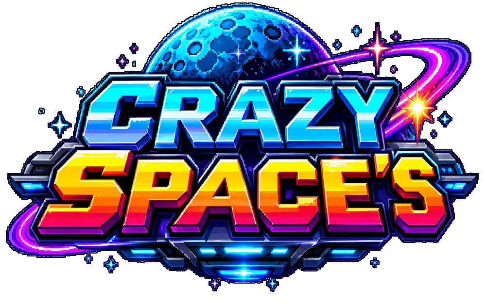

<p align="center"></p>

<p align="center"><b>Roguelike de naves en pixel art.</b> Sobrevive a oleadas, mejora tu nave y derrota a 5 jefes.</p>

<p align="center">
  <a href="https://diquipe98-eng.github.io/crazy-spaces/"><b>▶ JUGAR EN EL NAVEGADOR</b></a>
  &nbsp;·&nbsp; <a href="https://diquiller.itch.io/crazy-spaces"><b>itch.io</b></a>
  &nbsp;·&nbsp; <a href="https://paypal.me/QUILLERBY"><b>♥ APOYAR EL JUEGO (PayPal)</b></a>
</p>

## Cómo se juega
- **PC:** WASD o flechas para mover, Espacio para el dash, R para reparar, Esc para pausar.
- **Teléfono (horizontal):** joystick flotante en la mitad izquierda (o arrastre relativo en Ajustes), botón DASH a la derecha.
- El disparo es automático con autoapuntado. Sube de nivel, elige mejoras y desbloquea naves más fuertes con tu récord.

## Desarrollo
Hecho con **Godot 4.7** (GDScript).
```
flatpak run org.godotengine.Godot --path .                                     # abrir/jugar
flatpak run org.godotengine.Godot --headless --path . res://tests/prueba.tscn --fixed-fps 30
flatpak run org.godotengine.Godot --headless --path . res://tests/prueba_jefes.tscn
flatpak run org.godotengine.Godot --headless --path . res://tests/prueba_mejoras.tscn
```
Cada push a `main` exporta la versión web y la publica en GitHub Pages (`.github/workflows/web.yml`).
Diseño y balance: [`docs/diseno.md`](docs/diseno.md). Créditos y licencias de terceros: [`CREDITOS.md`](CREDITOS.md).

## Licencia
**Crazy Space's no es un proyecto de código abierto.** El código está publicado para que se pueda ver,
pero no se permite copiarlo, modificarlo, redistribuirlo ni venderlo sin permiso escrito del autor.
© Crazy Space's. Código y arte propios: todos los derechos reservados (ver `LICENSE`).
La música, los efectos de sonido y la fuente son de terceros con licencias libres (CC0 / OFL), ver `CREDITOS.md`.
